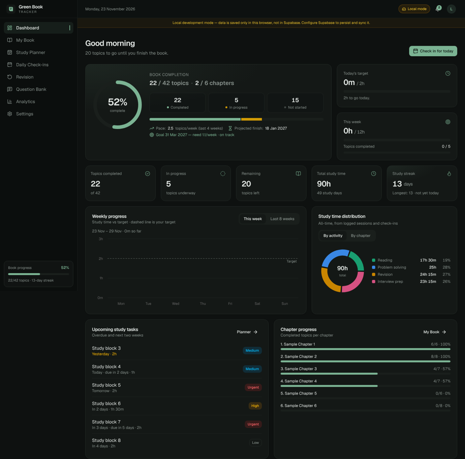

# Green Book Tracker

A personal study-management app for working systematically through *A Practical Guide to Quantitative Finance Interviews* (“The Green Book”) and preparing for quant interviews.

It tracks book completion topic by topic, daily check-ins and study streaks, plans and targets, revision, and an interview question bank, with analytics on top.

> **No book content is included.** The app has no built-in chapter list. You enter the structure yourself from your own copy, either by hand or by pasting an outline.



| Analytics | Planner | Mobile |
|---|---|---|
|  |  |  |

*(Screenshots use generated sample data.)*

---

## Features

| Area | What you can do |
|---|---|
| **Dashboard** | Book completion % ring, chapters/topics completed, in-progress and remaining counts, total study hours, current and longest streak, daily and weekly targets, a this-week or last-8-weeks chart against your target, study time by activity or chapter, upcoming tasks, per-chapter progress, completion pace, projected finish date, and on-track/behind status against an optional goal date. |
| **My Book** | Add, edit, reorder and delete chapters and topics. Set status (Not started / In progress / Completed) with automatic completion dates, Easy/Medium/Hard difficulty, 1–5 confidence, notes and formulas, and revision-list membership. Each topic keeps a revision history and count. You can **import an outline** (text or JSON) and search and filter topics. |
| **Daily check-ins** | Record whether you studied, which topics, minutes, problems solved, what you learned, difficulties, and tomorrow's focus. Includes a month calendar heat-map, yesterday's planned focus as a prompt, extra session logging, and a full check-in and session history. |
| **Study planner** | Week board with tasks per day. Set custom daily targets per day, weekly goals (hours and topics), deadlines and priorities. Reschedule tasks (move to today, push a day, pick a date, or move all overdue tasks). Includes a backlog, a deadline list, and a planned-vs-actual chart. |
| **Revision** | Tabs for *due for revision*, *revision list*, *low confidence*, and *not studied lately* (thresholds are configurable), plus a searchable formulas & concepts sheet. You can log a revision with confidence-after and notes. |
| **Question bank** | Add your own interview questions (category, difficulty, tags, source, linked topic, hidden solution). Record attempts as correct or wrong, with time spent, mistake and lesson. Shows solved counts and accuracy, plus a *Mistakes & lessons* log. |
| **Analytics** | Weekly review (this week vs last), daily study time, 12-week totals, book burn-up, 26-week activity heat-map, problems per week, time by chapter, confidence distribution, progress by difficulty, and question accuracy by category. |
| **Settings** | Display name, timezone, week start, daily/weekly/topic targets, revision and staleness intervals, goal date, reminder configuration, browser notification permission, JSON export and restore (restore imports into Supabase without duplicating existing rows), and light/dark theme. |

## Reminders: what actually works

There are three distinct tiers, and the UI labels each one:

| Tier | Status | How it works |
|---|---|---|
| **In-app reminders** | ✅ Working | While the app is open in a tab, a scheduler checks every 30 s. When a reminder's configured time has passed (in *your* timezone), its condition is true, and it hasn't fired today, it shows a toast and an item in the bell menu. If you open the app later in the day, reminders you missed appear then. |
| **Browser notifications** | ✅ Working *while a tab is open* | Once you grant permission (Settings → Reminders), reminders with “Browser notification” enabled also show an OS notification through a minimal service worker (`public/sw.js`). This works when the tab is in the background, but **not after every tab is closed**. |
| **Push when the app is closed** | ❌ Not configured | This would need Web Push: VAPID keys, a push subscription stored per device, a `push` handler in the service worker, and a server-side scheduler (e.g. Supabase `pg_cron` plus an Edge Function sending via `web-push`). None of that is set up, and the app doesn't claim otherwise. |

Reminder types: daily check-in, unfinished daily target, upcoming/overdue deadlines (configurable lead days), weekly progress review, and topics due for revision. Each one has its own enable switch, time, days of the week, and browser-notification toggle.

## Tech stack

Next.js 15 (App Router) · TypeScript · Tailwind CSS v4 · shadcn/ui (Radix primitives) · Supabase (Postgres + Auth + RLS) · Recharts · Lucide · date-fns / date-fns-tz · sonner · Vercel

## Architecture

```
src/
  app/
    (app)/            # authenticated app shell: sidebar + header + data provider
      dashboard/ book/ planner/ check-ins/ revision/ questions/ analytics/ settings/
    login/            # Supabase email+password / magic-link sign-in
    auth/callback/    # OAuth/magic-link code exchange
  components/
    ui/               # shadcn/ui components
    layout/           # app shell, reminder engine
    book/ planner/    # feature dialogs
    charts/           # Recharts wrappers (validated colour palette)
  lib/
    data/
      backend.ts            # storage interface
      supabase-backend.ts   # Supabase implementation (publishable key + RLS)
      local-backend.ts      # read-only reader for legacy localStorage data
      local-import.ts       # legacy/backup → Supabase import (remap, import, verify)
      self-test.ts          # Settings → "Test database connection"
      store.tsx             # React context: state + domain actions
    metrics.ts        # pure functions: progress, streaks, pace, revision buckets…
    reminders.ts      # reminder conditions
    dates.ts          # timezone-aware date helpers
    outline.ts        # outline import parser
  middleware.ts       # session refresh + route protection
supabase/migrations/  # SQL schema, constraints, triggers, RLS policies, import function
scripts/test-schema.mjs  # runs every migration in PGlite and checks RLS/cascades/import
```

- **All study data lives in Supabase.** Pages only talk to `useStore()`, which reads and writes Supabase as the signed-in user. If the Supabase variables are missing the app shows a configuration error instead of silently saving to the browser. `localStorage` is used only for UI conveniences (which reminders were already shown) and, read-only, to find data saved by older versions so it can be imported.
- **Legacy data import.** If the browser still has data from the old local mode, a banner offers *Review & import* (Settings → Data & account). The import gives each row a fresh ID, remaps references, skips days that already exist in your account, and sends everything to `import_local_snapshot()` which inserts it **in a single transaction** (all-or-nothing) and records a fingerprint so it can't be imported twice. The app then reads every row back to verify it. The local copy is kept until you choose *Remove local copy*, which refuses unless that exact data was verified in your account.
- **Study time has one source of truth:** `study_sessions`. Saving a check-in creates or updates one linked session; extra sessions can be logged separately. Totals, streaks, targets and charts all derive from sessions and check-ins.
- **Dates** are stored as calendar days (`yyyy-MM-dd`) in your configured timezone. “Today” and reminder times use that timezone, not the server's.

### Database

Tables: `profiles` (user profile + settings), `chapters`, `topics`, `check_ins` (daily check-ins), `check_in_topics`, `study_sessions`, `study_tasks`, `daily_targets`, `weekly_goals`, `revision_records`, `interview_questions`, `question_attempts`, `reminders`, `data_imports` (import log).

| Migration | Contents |
| --- | --- |
| `20261123000000_initial_schema.sql` | all study tables, constraints, `updated_at` triggers, new-user trigger, RLS policies |
| `20261124000000_local_data_import.sql` | `data_imports` table + RLS, `import_local_snapshot()` (security invoker, transactional) |
| `20261124100000_data_api_grants.sql` | explicit `GRANT`s to `authenticated` (none to `anon`). Required on Supabase projects created after 30 May 2026, which no longer expose new tables to the API automatically |

- Every user-owned table has `user_id` and **Row Level Security**, with separate select/insert/update/delete policies restricted to `auth.uid() = user_id`.
- Foreign keys are **composite `(id, user_id)`**, so a row can never reference another user's chapter, topic or question.
- Deletes cascade where data is owned (chapter → topics → revisions). Where history should survive, the reference is set to null (deleting a topic keeps its study sessions but unlinks them).
- A `handle_new_user` trigger creates the profile and default reminders on sign-up.
- `npm run test:db` runs all migrations in an in-memory Postgres and checks RLS isolation, cross-user FK rejection, cascades, constraints, and that imports are atomic, idempotent, owned by the caller and refused when signed out.

---

## Local development

Requires Node 20+.

```bash
git clone https://github.com/<your-username>/green-book-tracker.git
cd green-book-tracker
npm install
cp .env.example .env.local   # then fill in your Supabase URL + publishable key
npm run dev
```

Open <http://localhost:3000>. You'll be sent to `/login` to create an account or sign in.

Useful scripts:

```bash
npm run dev        # dev server on :3000
npm run build      # production build
npm run start      # serve the production build
npm run lint       # ESLint
npm run typecheck  # tsc --noEmit
npm run test:db    # verify the SQL schema + RLS in PGlite
```

## Configure Supabase

### 1. Environment variables

Copy `.env.example` to `.env.local` and fill in two values from the Supabase dashboard → **Project Settings → API Keys** (and **Data API** for the URL):

```
NEXT_PUBLIC_SUPABASE_URL=https://<project-ref>.supabase.co
NEXT_PUBLIC_SUPABASE_PUBLISHABLE_KEY=sb_publishable_...
```

Older projects can use the legacy `anon` key in `NEXT_PUBLIC_SUPABASE_ANON_KEY` instead; the publishable key wins if both are set.
⚠️ Never put the **secret** (`sb_secret_…`) or **service_role** key in this app. It bypasses RLS. This app never needs it.

Restart `npm run dev` after editing `.env.local` (Next.js reads it at startup).

### 2. Create the database (run once, in order)

In the dashboard open **SQL Editor → New query**, and for each file below: paste its full contents, click **Run**, and wait for "Success. No rows returned".

1. `supabase/migrations/20261123000000_initial_schema.sql`
2. `supabase/migrations/20261124000000_local_data_import.sql`
3. `supabase/migrations/20261124100000_data_api_grants.sql`

If file 1 says a relation "already exists", the schema is already installed, so go on to file 2. Files 2 and 3 are safe to re-run.
If the app shows **"permission denied for table …"**, file 3 hasn't been run. New Supabase projects don't grant tables to the API automatically.
CLI alternative: `supabase link --project-ref <ref>` then `supabase db push`.

Check: **Table Editor** should list 14 tables, and **Authentication → Policies** should show RLS enabled with owner policies on each one.

### 3. Authentication

In **Authentication → URL Configuration**:
- **Site URL:** `http://localhost:3000` (use your Vercel URL once deployed).
- **Redirect URLs:** add `http://localhost:3000/auth/callback` and `https://<your-app>.vercel.app/auth/callback`.

In **Authentication → Sign In / Providers → Email**, Email is enabled by default. With **Confirm email** on (the default), new accounts must click the emailed link before they can sign in. Supabase's built-in mailer is rate-limited (a few emails per hour), so configure custom SMTP for regular use, or turn confirmation off while developing.

Sessions are stored in cookies by `@supabase/ssr` and refreshed by `src/middleware.ts`, so you stay signed in across reloads and browser restarts until you sign out.

### 4. Verify

Run `npm run dev`, create an account, then go to **Settings → Data & account → Test database connection**. It creates, reads, updates and deletes a test record in every table as your user, confirms RLS rejects writes for another user ID, checks cascades, and removes everything it created. All checks should be green.

If you used the app before Supabase was set up, sign in in the **same browser** and use **Review & import** to move that data into your account.

## Deploy on Vercel

1. Push the repo to GitHub (already done if you're reading this there).
2. In Vercel, choose **Add New → Project**, import `green-book-tracker`, and keep the auto-detected Next.js settings.
3. Under **Environment Variables**, add `NEXT_PUBLIC_SUPABASE_URL` and `NEXT_PUBLIC_SUPABASE_PUBLISHABLE_KEY` for Production (and Preview if you want).
4. Deploy, then add the deployment URL to Supabase *Site URL* and *Redirect URLs* (`https://<app>.vercel.app/auth/callback`).

If you deploy without the variables, the site shows a "Supabase isn't configured" message instead of working.

CLI alternative: `npm i -g vercel && vercel && vercel env add NEXT_PUBLIC_SUPABASE_URL && vercel env add NEXT_PUBLIC_SUPABASE_PUBLISHABLE_KEY && vercel --prod`.

## What still needs external configuration

- **Supabase project + keys + all three SQL migrations + auth redirect URLs.** Without them, the app can't load.
- **Email delivery** for confirmation and magic links. Supabase's default sender is rate-limited; configure SMTP for real use.
- **Push notifications while the app is closed.** Not implemented. Requires VAPID keys, a subscriptions table, a service-worker `push` handler, and a scheduled sender (e.g. Supabase cron + Edge Function).

## Security notes

- Only the Supabase publishable (anon) key is used, client- and server-side. All access control is enforced by RLS in the database; no secret or service-role key is used anywhere.
- `import_local_snapshot()` is `SECURITY INVOKER` (runs with the caller's permissions, so RLS applies), forces `user_id = auth.uid()`, and is not executable by signed-out (`anon`) callers.
- No secrets are committed. `.env*` is git-ignored except `.env.example`.
- The auth callback only redirects to same-site relative paths.

## License

MIT. Book content is not included and remains the property of its authors and publisher.
