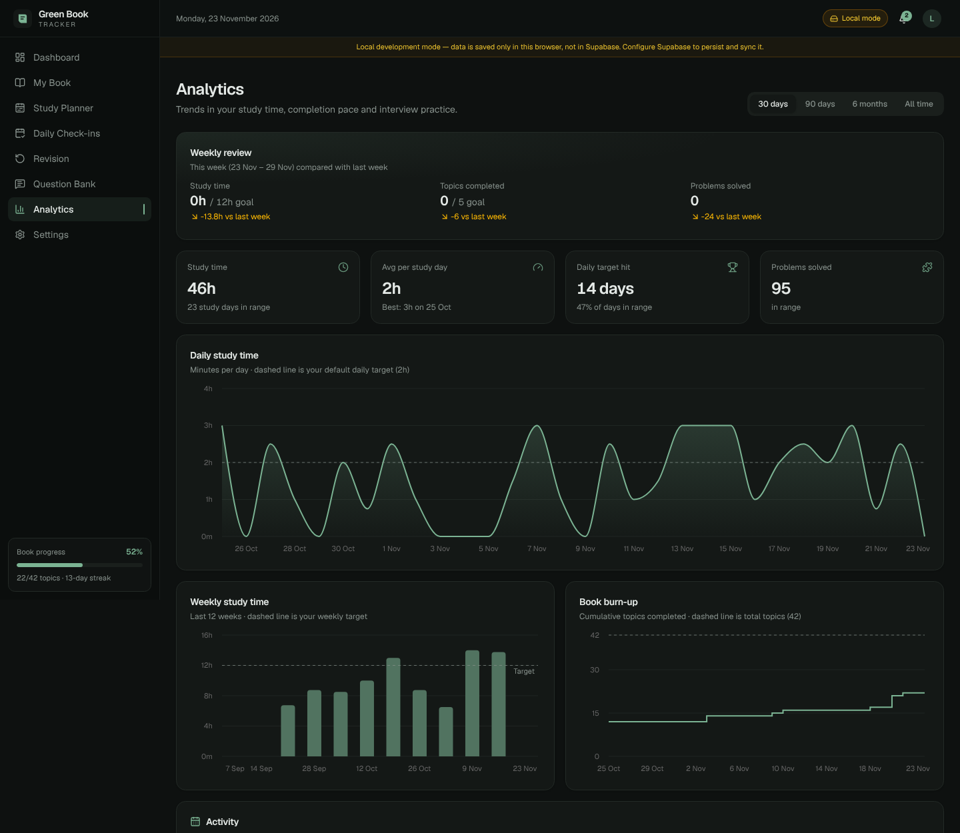
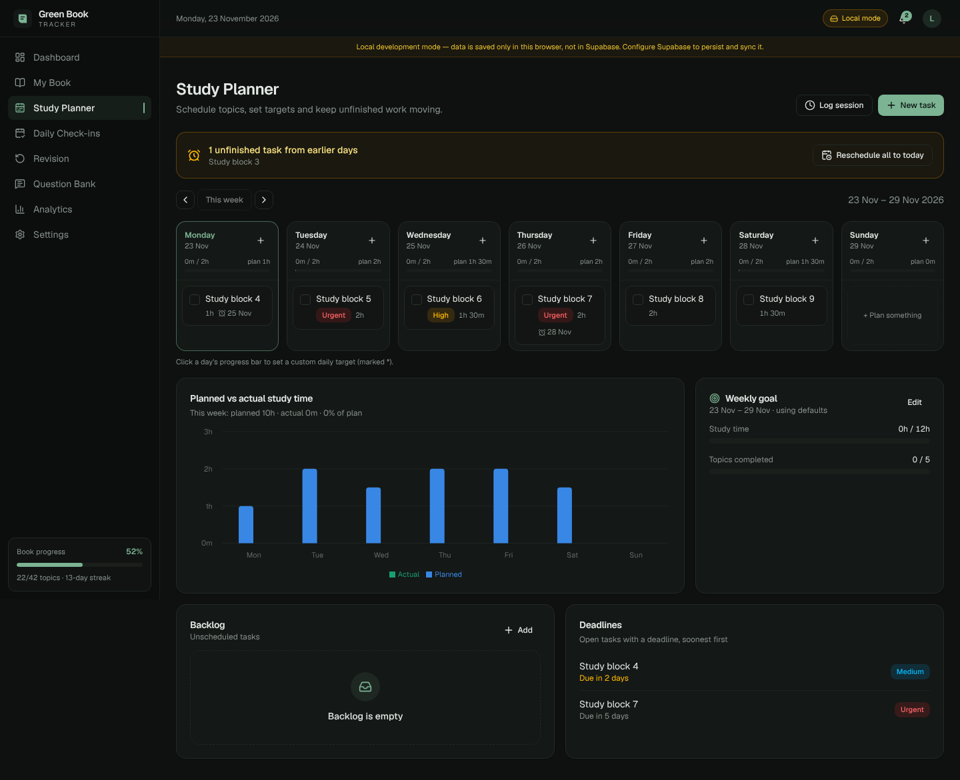
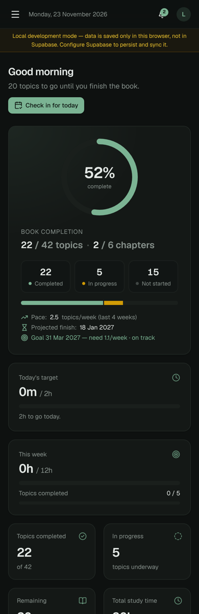

# Green Book Tracker

A personal study-management app for working systematically through *A Practical Guide to Quantitative Finance Interviews* (“The Green Book”) and preparing for quant interviews.

It tracks book completion topic by topic, daily check-ins and study streaks, plans and targets, revision, and an interview question bank, with analytics on top.

> **No book content is included.** The app has no built-in chapter list. You enter the structure yourself from your own copy, either by hand or by pasting an outline.


| Analytics | Planner | Mobile |
|---|---|---|
|  |  |  |

*(Screenshots use generated sample data.)*

---

## Features

| Area | What you can do |
|---|---|
| **Dashboard** | Book completion % ring, chapters/topics completed, in-progress and remaining counts, total study hours, current and longest streak, daily and weekly targets, a this-week or last-8-weeks chart against your target, study time by activity or chapter, upcoming tasks, per-chapter progress, completion pace, projected finish date, and on-track/behind status against an optional goal date. |
| **My Book** | Add, edit, reorder and delete chapters and topics. Set status (Not started / In progress / Completed) with automatic completion dates, Easy/Medium/Hard difficulty, 1–5 confidence, notes and formulas, and revision-list membership. Each topic keeps a revision history and count. You can **import an outline** (text or JSON) and search and filter topics. |
| **Daily check-ins** | Record whether you studied, which topics, minutes, problems solved, what you learned, difficulties, and tomorrow's focus. Includes a month calendar heat-map, yesterday's planned focus as a prompt, extra session logging, and a full check-in and session history. |
| **Study planner** | Week board with tasks per day. Set custom daily targets per day, weekly goals (hours and topics), deadlines and priorities. Reschedule tasks (move to today, push a day, pick a date, or move all overdue tasks). Includes a backlog, a deadline list, and a planned-vs-actual chart. |
| **Revision** | Tabs for *due for revision*, *revision list*, *low confidence*, and *not studied lately* (thresholds are configurable), plus a searchable formulas & concepts sheet. You can log a revision with confidence-after and notes. |
| **Question bank** | Add your own interview questions (category, difficulty, tags, source, linked topic, hidden solution). Record attempts as correct or wrong, with time spent, mistake and lesson. Shows solved counts and accuracy, plus a *Mistakes & lessons* log. |
| **Analytics** | Weekly review (this week vs last), daily study time, 12-week totals, book burn-up, 26-week activity heat-map, problems per week, time by chapter, confidence distribution, progress by difficulty, and question accuracy by category. |
| **Settings** | Display name, timezone, week start, daily/weekly/topic targets, revision and staleness intervals, goal date, reminder configuration, browser notification permission, JSON export (plus restore in local mode), and light/dark theme. |

## Reminders: what actually works

There are three distinct tiers, and the UI labels each one:

| Tier | Status | How it works |
|---|---|---|
| **In-app reminders** | ✅ Working | While the app is open in a tab, a scheduler checks every 30 s. When a reminder's configured time has passed (in *your* timezone), its condition is true, and it hasn't fired today, it shows a toast and an item in the bell menu. If you open the app later in the day, reminders you missed appear then. |
| **Browser notifications** | ✅ Working *while a tab is open* | Once you grant permission (Settings → Reminders), reminders with “Browser notification” enabled also show an OS notification through a minimal service worker (`public/sw.js`). This works when the tab is in the background, but **not after every tab is closed**. |
| **Push when the app is closed** | ❌ Not configured | This would need Web Push: VAPID keys, a push subscription stored per device, a `push` handler in the service worker, and a server-side scheduler (e.g. Supabase `pg_cron` plus an Edge Function sending via `web-push`). None of that is set up, and the app doesn't claim otherwise. |

Reminder types: daily check-in, unfinished daily target, upcoming/overdue deadlines (configurable lead days), weekly progress review, and topics due for revision. Each one has its own enable switch, time, days of the week, and browser-notification toggle.

## Tech stack

Next.js 15 (App Router) · TypeScript · Tailwind CSS v4 · shadcn/ui (Radix primitives) · Supabase (Postgres + Auth + RLS) · Recharts · Lucide · date-fns / date-fns-tz · sonner · Vercel

## Architecture

```
src/
  app/
    (app)/            # authenticated app shell: sidebar + header + data provider
      dashboard/ book/ planner/ check-ins/ revision/ questions/ analytics/ settings/
    login/            # Supabase email+password / magic-link sign-in
    auth/callback/    # OAuth/magic-link code exchange
  components/
    ui/               # shadcn/ui components
    layout/           # app shell, reminder engine
    book/ planner/    # feature dialogs
    charts/           # Recharts wrappers (validated colour palette)
  lib/
    data/
      backend.ts            # storage interface
      supabase-backend.ts   # Supabase implementation (anon key + RLS)
      local-backend.ts      # localStorage implementation (local mode)
      store.tsx             # React context: state + domain actions
    metrics.ts        # pure functions: progress, streaks, pace, revision buckets…
    reminders.ts      # reminder conditions
    dates.ts          # timezone-aware date helpers
    outline.ts        # outline import parser
  middleware.ts       # session refresh + route protection (Supabase mode)
supabase/migrations/  # SQL schema, constraints, triggers, RLS policies
scripts/test-schema.mjs  # runs the migration in PGlite and checks RLS/cascades
```

- **One storage interface, two backends.** Pages only talk to `useStore()`. If the two `NEXT_PUBLIC_SUPABASE_*` variables are set, data goes to Supabase. Otherwise the app runs in **local mode**: data is stored only in that browser's `localStorage`, there is no sign-in, and an amber banner says so on every page. Local mode mirrors the database's delete rules (cascade / set-null) so behaviour matches.
- **Study time has one source of truth:** `study_sessions`. Saving a check-in creates or updates one linked session; extra sessions can be logged separately. Totals, streaks, targets and charts all derive from sessions and check-ins.
- **Dates** are stored as calendar days (`yyyy-MM-dd`) in your configured timezone. “Today” and reminder times use that timezone, not the server's.

### Database

Tables: `profiles`, `chapters`, `topics`, `check_ins`, `check_in_topics`, `study_sessions`, `study_tasks`, `daily_targets`, `weekly_goals`, `revision_records`, `interview_questions`, `question_attempts`, `reminders`.

- Every user-owned table has `user_id` and **Row Level Security**, with separate select/insert/update/delete policies restricted to `auth.uid() = user_id`.
- Foreign keys are **composite `(id, user_id)`**, so a row can never reference another user's chapter, topic or question.
- Deletes cascade where data is owned (chapter → topics → revisions). Where history should survive, the reference is set to null (deleting a topic keeps its study sessions but unlinks them).
- A `handle_new_user` trigger creates the profile and default reminders on sign-up.
- `npm run test:db` runs the migration in an in-memory Postgres and checks RLS isolation, cross-user FK rejection, cascades and constraints.

---

## Local development

Requires Node 20+.

```bash
git clone https://github.com/<your-username>/green-book-tracker.git
cd green-book-tracker
npm install
cp .env.example .env.local   # leave blank for local mode, or add Supabase values
npm run dev
```

Open <http://localhost:3000>. Without Supabase values you're in local mode immediately.

Useful scripts:

```bash
npm run dev        # dev server on :3000
npm run build      # production build
npm run start      # serve the production build
npm run lint       # ESLint
npm run typecheck  # tsc --noEmit
npm run test:db    # verify the SQL schema + RLS in PGlite
```

## Configure Supabase

1. Create a project at <https://supabase.com/dashboard>.
2. **Run the schema.** Open *SQL Editor → New query*, paste the full contents of `supabase/migrations/20261123000000_initial_schema.sql`, and run it.
   Or, with the Supabase CLI: `supabase link --project-ref <ref>` then `supabase db push`.
3. **Get the keys.** Go to *Project Settings → API* and copy the **Project URL** and the **anon / publishable** key into `.env.local`:
   ```
   NEXT_PUBLIC_SUPABASE_URL=https://xxxx.supabase.co
   NEXT_PUBLIC_SUPABASE_ANON_KEY=eyJ...
   ```
   ⚠️ Never use the `service_role` key in this app. It bypasses RLS and must never be given a `NEXT_PUBLIC_` prefix or committed.
4. **Auth URLs.** Go to *Authentication → URL Configuration*:
   - **Site URL:** `http://localhost:3000` for development, or your Vercel URL in production.
   - **Redirect URLs:** add `http://localhost:3000/auth/callback` and `https://<your-app>.vercel.app/auth/callback`.
5. *(Optional)* In *Authentication → Providers → Email*, decide whether to require email confirmation. If it's on, new accounts must click the confirmation link before signing in. Supabase's built-in email sender is rate-limited, so set up custom SMTP for regular use.
6. Restart `npm run dev`. You'll be sent to `/login`. Create an account, and your data will be stored in Supabase.

> Data created in local mode stays in that browser. To move it, use *Settings → Export JSON backup*. Importing a backup into Supabase isn't built in yet.

## Deploy on Vercel

1. Push the repo to GitHub (already done if you're reading this there).
2. In Vercel, choose **Add New → Project**, import `green-book-tracker`, and keep the auto-detected Next.js settings.
3. Under **Environment Variables**, add `NEXT_PUBLIC_SUPABASE_URL` and `NEXT_PUBLIC_SUPABASE_ANON_KEY` for Production (and Preview if you want).
4. Deploy, then add the deployment URL to Supabase *Site URL* and *Redirect URLs* (`https://<app>.vercel.app/auth/callback`).

If you deploy without the variables, the site runs in local mode: each visitor's data stays in their own browser.

CLI alternative: `npm i -g vercel && vercel && vercel env add NEXT_PUBLIC_SUPABASE_URL && vercel env add NEXT_PUBLIC_SUPABASE_ANON_KEY && vercel --prod`.

## What still needs external configuration

- **Supabase project + keys + auth redirect URLs.** Without them, the app runs in local (browser-only) mode.
- **Email delivery** for confirmation and magic links. Supabase's default sender is rate-limited; configure SMTP for real use.
- **Push notifications while the app is closed.** Not implemented. Requires VAPID keys, a subscriptions table, a service-worker `push` handler, and a scheduled sender (e.g. Supabase cron + Edge Function).
- **Importing a local-mode backup into Supabase.** Export works in both modes; restore works only in local mode.

## Security notes

- Only the Supabase anon key is used client-side. All access control is enforced by RLS in the database.
- No secrets are committed. `.env*` is git-ignored except `.env.example`.
- The auth callback only redirects to same-site relative paths.

## License

MIT. Book content is not included and remains the property of its authors and publisher.
